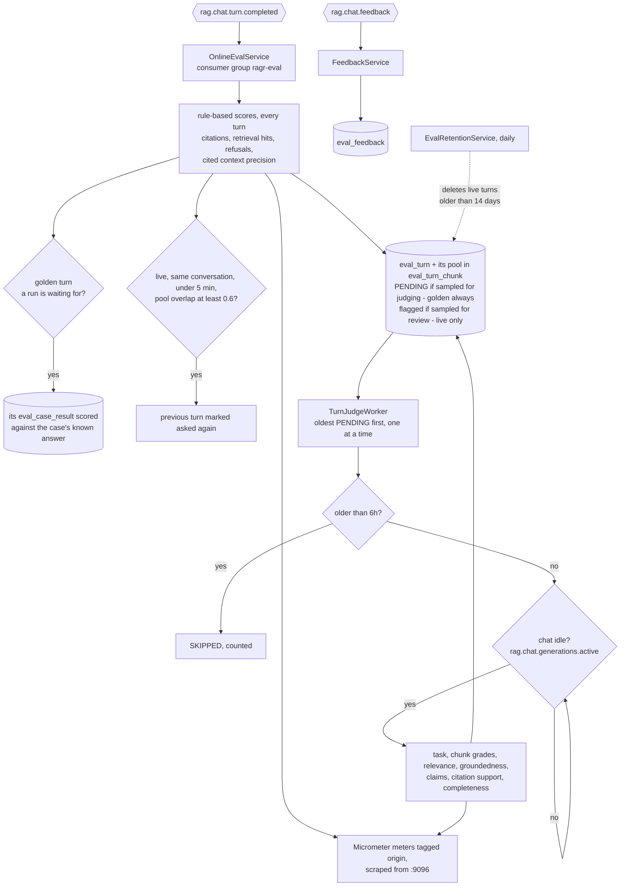
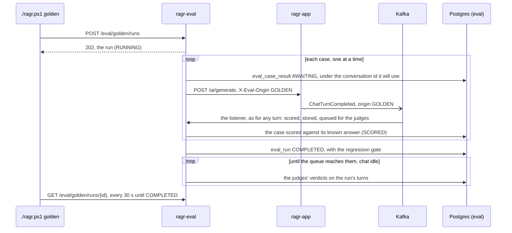

# ragr-eval

The evaluation service. It measures how good chat's answers are, without ever being in the way of
one. It runs on port **9096** (actuator, golden runs and human review) and owns the `eval` schema, with
its own Flyway history.

- **Live traffic.** Every answer [ragr-app](../ragr-app/README.md) publishes to Kafka is scored, stored
  and, while chat is idle, judged by the model.
- **Signals from people.** Users' thumbs up or down, and reviewers' verdicts.
- **The golden suite.** A fixed set of questions with known answers, run on demand over HTTP and
  evaluated exactly like live traffic.

Nothing else publishes `rag_eval_*` metrics. If ragr-eval is down, chat carries on and turns wait on
the topic (3 days' retention) until it is back.

How it fits with the other applications is in the [root README](../README.md).

## Design choices

- **Off the chat path, twice over.** Kafka takes scoring off chat's thread. An *idle gate* takes judging
  off chat's model: before every judge call the worker checks ragr-app's
  `rag.chat.generations.active` gauge, and waits while it is above zero.
- **Cheap scores for every turn, judges where it pays.** Rule-based scores (citations, retrieval hits,
  refusals) cost nothing and cover 100% of turns within seconds. The model-based judges are slower, so
  they run from a queue, one turn at a time.
- **Many short judge calls, not a few long ones.** A user arriving mid-judgement waits for at most the
  one call already running - 1 to 22 seconds each, measured 6 Oct 2026.
- **One path for live and golden turns.** Both arrive on the same topic, are scored by the same
  listener, wait in the same judge queue and get the same judges, so the two dashboards' shared panels
  mean the same thing. A golden turn only adds a check against its case's known answer.
- **Score what the model saw.** The turn event carries every chunk in the prompt and the rest of the
  retrieved pool, so evaluation never re-queries the vector store and can measure what retrieval missed.
- **Old work is dropped, not done late.** A turn not judged within 6 hours is skipped and counted, so the
  queue never describes traffic from hours ago.

## What it measures

Every metric of the "how do you measure RAG accuracy" framework, for both the golden suite and live
traffic:

| | Golden suite | Live traffic |
|---|---|---|
| **Retrieval** - Recall@K, Precision@K, MRR, NDCG | against hand-checked expected files or pages, over the candidate pool | from the judge grading every chunk in the candidate pool |
| **Generation** - faithfulness, relevance, completeness, citation correctness | the same judges, on every turn of every run | the same judges, on every sampled turn |
| **End to end** - success, task breakdown, debugging matrix | case pass rate, the regression gate, and the judges' verdict | the judges' verdict, thumbs up/down, "asked again", human review |

Golden retrieval is measured both ways: by the judge's chunk grades, exactly as live, and against the
expected sources, which only a known answer allows.

**Live retrieval metrics come from the candidate pool.** ragr-app's one vector query fetches 10
chunks; the prompt gets the top 5 above the threshold, and the event carries the rest. The judge grades
every chunk against the question - the whole answer, part of it, on the topic only, or unrelated - and a
chunk with the whole answer or part of it counts as relevant. Recall is *pooled*: relevant chunks in
the prompt divided by relevant chunks in the pool. That makes it an upper bound, since a relevant chunk
ranked below the pool is invisible to it.

**The judge is the chat model grading its own answers**, which makes the judged rates optimistic. A
dedicated judge would be better, but the smallest one built for the job (`bespoke-minicheck`) needs
4.39 GiB and does not fit beside the chat and embedding models. Read the judged rates as a trend - a
drop after a change means something - not as an absolute score. To move the judges to another model
server, point `spring.ai.ollama.base-url` at it.

## Online evaluation



**Every turn is scored and stored on arrival.** The rule-based scores are string comparisons over data
the event already carries. The turn and its whole pool go into `eval_turn` and `eval_turn_chunk`, so a
dashboard panel can show retrieval and generation for the *same* turn, and a reviewer can read exactly
what was judged.

**What a turn costs to judge.** A grounded turn takes about 40-70 s of judge time, spread over many
short calls. An ungrounded one - nothing cleared the similarity threshold, so the model answered from
general knowledge - only has its task classified and its pool graded, about 6 s; its answer is never
judged. A relevant chunk in that pool means a recall of 0: the threshold dropped context the answer
could have used.

**Watch the skipped counter.** A steadily rising `rag_eval_online_judge_skipped_total` means the
sample rate is too high for the traffic.

**Signals from users.**
- *Thumbs up or down*, from `POST /ai/turns/{turnId}/feedback` on ragr-app, arrives on
  `rag.chat.feedback` and is stored in `eval_feedback`.
- *Asked again* is the implicit thumbs-down: a follow-up in the same conversation within 5 minutes whose
  pool overlaps the previous one's by at least 0.6 marks the previous answer as asked again.

**Live turns are kept 14 days** (`retention.live-days`), then deleted with their pools and feedback.
They are the only copy of users' questions outside chat memory, which expires from Redis after 24 hours.

**Delivery is at most once, and a new consumer starts at the newest turn.** A turn chat could not
publish is lost. To replay the topic on purpose, reset the `ragr-eval` group's offsets.

## Human review

The live dashboard's "Answers to review" table lists unreviewed live turns worth a person's verdict: every thumbs-down,
every turn where the user and the judges disagree, and a random 5% (`online.review-sample-rate`).
Record a verdict - `CORRECT`, `PARTIAL` or `WRONG` - with:

```bash
curl -X PUT http://localhost:9096/eval/turns/<turnId>/review -H "Content-Type: application/json" -d '{"verdict":"CORRECT","notes":"optional"}'
```

204 on success; 404 for a turn never stored, or already purged. The live dashboard compares each
verdict with the judges'. That comparison is the evidence for whether the model is good enough to judge itself.

## The golden suite

24 questions in `src/main/resources/eval/golden-dataset.yaml`, scored against the Markdown library. Each case has:

| Field | Meaning |
|---|---|
| `expectedFiles` | The files that hold the answer, for sources without pages such as Markdown: every chunk of one counts as relevant. Checked by reading the retrieved chunks rather than guessed |
| `expectedFilesMode` | For several files: whether the answer needs all of them (`ALL`) or any one (`ANY`) - `ANY` where projects share a page word for word |
| `relevantFiles` | Other files that hold part of the answer. Used only to calibrate the judge |
| `expectedFile`, `expectedPages`, `expectedPagesMode`, `relevantPages` | The same, by page, for one paged file (a PDF). A case uses files or pages, never both |
| `task` | The kind of question, for the per-task breakdown |
| `mustContain`, `mustNotContain` | Phrases the answer must or must not contain, case-insensitive |
| `mustNotMatch` | Regular expressions the answer must not match - for a wrong answer that uses the same words as a right one |

On top of the live metrics, the suite adds those that need known-correct sources: file- or page-level
Recall@K, hit rate, MRR, and precision and NDCG with expected chunks as the relevant ones.

**Precision@K is scored three ways**, because each way of deciding "was this chunk useful?" is wrong in
its own direction:

- *Expected* - useful if it is in a file, or on a page, the dataset lists. A floor: the lists hold the
  sources with the answer, not every useful one.
- *Judged* - the judge grades the chunk against the question, exactly as for live turns.
- *Cited* - used if the answer cites its file (or page). Free and exact, but a passage used without a
  citation counts as unused.



**Running it.** ragr-app must be up with the corpus stored, and warmed with one chat turn after a
restart; ragr-eval runs the suite itself, so nothing else is stopped or started.

```bash
./ragr.ps1 golden          # start a run, wait until every case is scored (~15 min), print the summary
./ragr.ps1 golden latest   # the latest run, with how far the judges have got through its turns
```

The same over HTTP: `POST /eval/golden/runs` returns 202 with the run (409 while another is running),
and `GET /eval/golden/runs/{runId}` or `/latest` follow it.

**A run completes when every case is scored, not judged.** Its regression gate uses only rule-based
scores: it fails if any answer cites a page that does not exist, if the citation fabrication rate is
above 0.10, or if the retrieval hit rate is below 0.6 (`GoldenGate`). `./ragr.ps1 golden` exits 1 on a
failed gate. The judges' verdicts arrive on the run's turns as the queue reaches them, beside live
turns, and never change a case's pass. A turn that never arrives fails its case after `turn-timeout`; a
run interrupted by a restart is marked FAILED when ragr-eval starts again.

## Configuration

All of it is in `src/main/resources/application.yaml`. There are no profiles. Evaluation is configured
under `app.eval.*`:

| Property | Default | Purpose |
|---|---|---|
| `enabled` | `true` | Turns all evaluation on or off |
| `topic` | `rag.chat.turn.completed` | Where chat publishes turns |
| `feedback-topic` | `rag.chat.feedback` | Where chat publishes ratings |
| `judge-model` | `gemma4:e2b` | The judges' model - the chat model itself, see above |
| `online.judge-sample-rate` | `1.0` | Share of live turns queued for judging. `0.0` keeps the free scores and stores turns unjudged. Golden turns are always queued |
| `online.review-sample-rate` | `0.05` | Random share of live turns put in the review queue |
| `online.rephrase-window` / `rephrase-overlap` | `5m` / `0.6` | When a follow-up counts as the same question asked again |
| `judge.worker-enabled` | `true` | Whether this process judges queued turns and recovers interrupted golden runs. Off in the context test |
| `judge.max-backlog-age` | `6h` | A queued turn older than this is skipped and counted |
| `judge.call-timeout-seconds` | `120` | Longest one judge call may take; past it, that stage is recorded as not measured |
| `judge.shutdown-wait-seconds` | `20` | How long shutdown lets the turn being judged finish before interrupting it (it goes back in the queue). Must fit inside the container's 40 s `stop_grace_period` |
| `judge.faithfulness-threshold` | `0.8` | Share of claims that must be supported for an answer to count as a success |
| `judge.max-claims` / `claims-num-predict` | `8` / `400` | Most claims taken from one answer, and the output limit for the two judges that write lists |
| `judge.idle-gate.enabled` | `true` | Hold judge calls while chat is generating. Turn off only if the judges use a different model server |
| `judge.idle-gate.chat-actuator-url` | `http://localhost:9095` | ragr-app's actuator; `http://ragr-app:9095` in the container |
| `retention.live-days` | `14` | Live turns, pools and feedback older than this are deleted daily |
| `golden.chat-url` | `http://localhost:8080` | The running chat service a run drives; `http://ragr-app:8080` in the container |
| `golden.turn-timeout` | `30s` | How long a run waits, after its last answer, for every case's turn to be scored; a case still waiting fails |

## Dashboards

Two Grafana dashboards answer *are the answers any good?*, one per source, never mixed. Each has the same
sections, top to bottom:

| Section | Asks |
|---|---|
| **At a glance** | the headline numbers and a trend |
| **Retrieval** | did the search find the right passages? |
| **Generation** | is the answer itself good - backed by its sources, on topic, complete, cited correctly? |
| **End to end** | did the whole pipeline work - where answers go wrong, by kind of question |
| **Can we trust the judge?** | how often the judge agrees with a more trusted opinion |
| **Drill-down** | which answers or cases, and why |
| **Detail** (collapsed) | the finer measures behind the sections above |

- **ragr-eval — live answers** - live turns in the time range, filtered by the **Task** variable. Also
  human verdicts (correct, partly correct, wrong), user feedback and response time; the judge compared with human reviewers and with thumbs up/down; the
  review queue and failing answers; a collapsed **Judge workload** row (skips, errors, time per answer);
  and running totals (refusals, citation outcomes) and search scores under
  Detail.
- **ragr-eval — golden test set** - one run, picked with the **Run** variable (the latest by default),
  plus one point per run over the time range (30 days by default). The panels the two dashboards share -
  search quality, answer quality, answer problems, the debugging matrix, by kind of question, response
  time, judge time, failing answers - use the same queries, scoped to the run's turns instead of a time
  range, so they compare directly. Golden only: the regression gate, how many of the run's turns are
  judged yet, retrieval against the expected sources, the test set's own checks, the judge compared with
  the hand-checked sources, every case with why it failed, pass history per case, run history, and
  precision three ways under Detail.

Quality panels read the `eval` schema - live by when each turn happened, golden by run; Prometheus
carries the judge queue and the running totals, its per-turn meters tagged `origin`. Re-ingests (and, on the golden dashboard, golden runs) are marked on every time
axis - a re-ingest as one shaded region per upload batch, uploads under 10 minutes apart merged. Every rate is shown beside how many answers it rests on: at a few turns an hour, a rate can rest
on very few verdicts. Labels are plain words with the standard term in brackets - "Useful passages used (Recall@K)",
"Backed by sources (Faithfulness)". Each panel's description (the ⓘ) says what it means, what to do when
it is bad and, for the headline metrics, an example target. Targets are not colour-coded: the judge is
the same small model that answers, so read the trend rather than the level.
